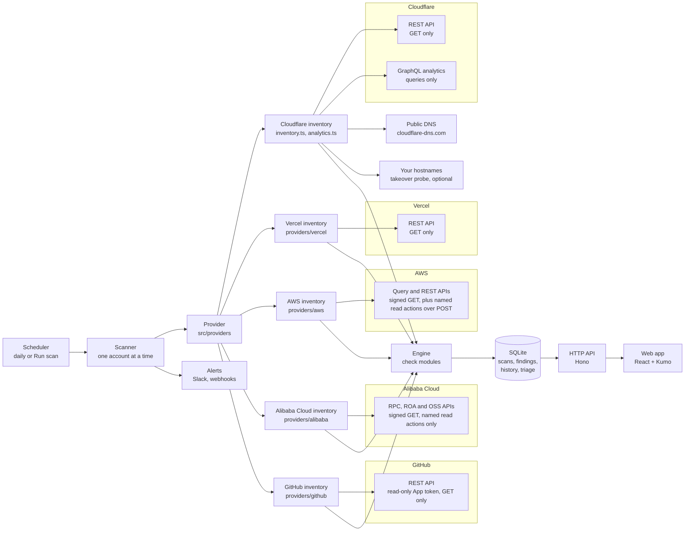

# How it works



## Providers

Every account belongs to one provider (Cloudflare, Vercel, AWS, Alibaba Cloud or GitHub), recorded on the account. The scanner, the account
routes and the Add accounts flow only talk to a provider through the `Provider` interface in `src/providers/types.ts`:
verify a credential, list the accounts it reaches, probe what it can read, and scan an account. `src/providers/index.ts`
lists them. Cloudflare's code predates providers and lives in `src/core`, wrapped by `src/providers/cloudflare.ts`;
Vercel's lives in `src/providers/vercel/`, AWS's in `src/providers/aws/`, Alibaba Cloud's in `src/providers/alibaba/` and GitHub's in `src/providers/github/`, and new providers get their own folder
the same way.

What the app says about a provider (its label, what it calls an account and a credential, the credential's fields,
its API host) comes from `PROVIDER_INFO` in `src/shared/providers.ts`, so screens and messages are worded for any
provider without comparing names.

What every provider shares: the check-module format and evaluator (`src/core/checks/define.ts`), the categories,
fingerprints and scoring (`src/core/engine.ts`), storage, triage, alerts and the whole web app. The dashboard's scope
is a set of accounts: all of them, an entity, one account, or any accounts ticked in the pickers (`s:<id>,<id>`),
optionally narrowed to one provider (`e:3@vercel`). Every scoped page follows it.

## A scan

The steps below are Cloudflare's; a Vercel scan reads teams, members, tokens, projects with their domains,
environment variable names and firewall, and the team's domains, certificates, drains and webhooks (about
four requests per project), then runs the same check, store and alert steps. An AWS scan reads IAM (the root
user, users with their keys and MFA, roles and policies), S3, CloudFront and Route 53 once, and security groups,
instances, EBS settings, VPCs, databases, load balancers, functions and GuardDuty in every enabled region
(about twelve requests per region, plus a few per user, bucket, load balancer and function). A region that
refuses the access key is skipped and recorded, rather than failing the scan. AWS has no client library here:
`src/providers/aws/sigv4.ts` signs each GET, and `src/core/xml.ts` reads the XML answers. An Alibaba Cloud scan reads RAM
(through IMS for users, their AccessKeys and last sign-ins), the main account's security practice report, OSS, CDN,
ActionTrail, Security Center and Alibaba Cloud DNS once, and security groups (one request each for their rules),
instances, interfaces and EIPs, disks, images, launch templates, VPCs, RDS, ALB, NLB and CLB load balancers, Function
Compute, KMS and ACK clusters in every region ECS lists. `src/providers/alibaba/sign.ts` signs each GET (Alibaba Cloud's
V3 signature for the RPC and ROA APIs, and OSS's V4), tested against Alibaba Cloud's published examples. A GitHub scan signs a JWT with the
App's private key (`node:crypto`), finds the App's installation on the organization, and asks for an installation
token limited to read permissions; with it, it reads the organization's settings, owners, Actions policy, webhooks
and installed Apps, then each repository's default branch protection and rulesets, deploy keys, webhooks and Pages
site (about six requests per repository), and the organization's open Dependabot, code scanning and secret scanning
alerts, and keeps each repository's SBOM ([below](#dependencies-a-software-bill-of-materials-per-repository)).

1. **Inventory.** For one account, Keelson reads everything the checks need into one typed `Inventory`:
   zones and their settings, DNS records, rulesets, certificates, members, tokens, Access, Gateway, Workers,
   R2, email routing and more, about 60 REST reads per account plus a few per zone. Every read is declared
   in `src/core/sources.ts` with the permission it needs; a read the token can't do is recorded as a coverage
   gap instead of failing the scan.
2. **Analytics.** GraphQL queries summarise the last 7 days of traffic: security actions, status codes,
   TLS versions, paths, leaked-credential checks, attack scores and more. Zones are batched by plan, since
   Free, Pro, Business and Enterprise expose different fields, and a field the plan can't read is dropped
   rather than failing the query.
3. **Checks.** Each module in `src/core/checks/` reads the inventory and reports pass or fail for every
   resource a check applies to. A check whose source couldn't be read is skipped, never passed.
4. **Store.** Findings get a stable fingerprint (check, account, zone, resource), so the same problem is
   the same finding from scan to scan. That's what carries triage, "first seen", "resolved" and "reopened"
   across scans.
5. **Alert.** New findings at or above the chosen severity, and findings that came back after being fixed,
   go to each entity's Slack channel or webhook.

The scanner never changes anything: REST calls are GET, GraphQL is POST but only ever queries, GitHub's
installation token request is the one other POST (it creates a token that can only read), and
`test/integration.test.ts` (Cloudflare), `test/vercel.test.ts` (Vercel), `test/aws.test.ts` (AWS) and
`test/github.test.ts` (GitHub) fail on any other request, and `test/alibaba.test.ts` (Alibaba Cloud) on any request that isn't a signed GET for a read action its policy names. AWS services whose APIs only accept POST (CloudTrail, KMS, Config, ECS and others) are read with POST, but only for the read actions named in `READ_ACTIONS` (`src/providers/aws/client.ts`): `rpc()` refuses any other before sending it, and `test/aws.test.ts` fails on a POST for any action that isn't on the list.

## Dependencies: a software bill of materials per repository

A GitHub scan also keeps an SBOM of each repository (`src/providers/github/sbom/`), with Anchore's open-source
tools when they're installed where Keelson runs (`src/core/anchore.ts`: `KEELSON_SYFT`, `KEELSON_GRYPE` and
`KEELSON_GRANT`, or each on the PATH):

1. **File list.** One request per repository reads the default branch's file list (`git/trees`, recursive; folder
   by folder when GitHub cuts it short). `manifests.ts` picks the files that describe dependencies: package
   manifests and lock files, GitHub Actions workflows and Dockerfiles, outside installed packages, build output and
   test fixtures. Source code is never fetched. This needs the App's **Contents** permission; without it the
   `manifests` source is a coverage gap and nothing is listed.
2. **SBOM.** The cache key is every picked file's path and blob SHA, and Syft's version. When it matches the
   repository's cached SBOM (`provider_cache`, `sbom:<repo>`), nothing more is fetched. Otherwise the files are
   fetched by blob SHA, written to a temporary folder, read by Syft (`syft scan dir:… -o syft-json`, with no
   network lookups and no file listing) and deleted. Only Syft's packages and their relationships are kept, with
   what Keelson read from the files itself: the repository's parts (each project of a monorepo, with its name,
   ecosystems, lock file, the dependencies its own manifest names, packages it installs without a pinned version,
   and its Dockerfiles' base images), the actions its workflows use, and npm's development-only packages.
3. **Vulnerabilities and licenses.** Every repository's packages are combined, one per identity (type and purl),
   into one Syft document, and Grype matches it once per scan, so a vulnerability published today is found in
   code that didn't change. Grype's own database (about 3 GB) lives under `<data-dir>/tools/grype` and is
   refreshed from Anchore when a newer one is published. An advisory and its CVE are merged into one
   vulnerability, keeping the smallest fixing version, CISA's known-exploited flag and FIRST's EPSS. Grant sorts each
   license into permissive, weak or strong copyleft; an `OR` expression takes its least restrictive choice.
4. **Where each package is used.** A package is attributed to the parts whose manifest names it (direct), the
   parts that reach it through Syft's dependency graph (through another package), or the part holding its lock
   file. A package used only by development dependencies, or only in examples and tests, is development only.
5. **Checks and views.** `checks/dependencies.ts` reports one finding per package and repository, whatever its
   version, so triage survives an upgrade that's still vulnerable. Each repository's view for the Repositories
   page is cached as `deps:<repo>`, and `GET /api/dependencies` and `GET /api/dependencies/sbom` (CycloneDX, SPDX
   through `syft convert`, or Syft JSON) read it. The Dependencies page reads every repository in view through `src/server/sbom.ts`, which
   indexes those views once per account and scan and filters them per request (`/api/sbom/*`).

The tools never get Keelson's environment: each runs with the PATH, a temporary home, proxy settings and its own
settings only. The mock (`dev/mock/anchore.ts`) replaces them in tests and the mock dev server.

## Container images: from the repository to what runs

AWS, Alibaba Cloud and GitHub scans also look at container images (`src/core/images.ts`, shared by the three),
with Aqua's Trivy when it's installed where Keelson runs (`src/core/trivy.ts`: `KEELSON_TRIVY`, or `trivy` on the
PATH):

1. **What exists.** Each platform lists its registry: ECR repositories' images with their tags, push and last
   pull dates (`ecr:DescribeImages`), Container Registry Enterprise Edition instances' repositories and tags, and
   the GitHub organization's container packages. An image pushed as an index (several platforms, or with build
   attestations) appears in ECR as the index and each of its parts; the index's manifest is read
   (`ecr:BatchGetImage`) and its parts folded into it, with the platforms it has. It also lists the workloads that run images and publishes them to
   the entity (`awsWorkloads`, `alibabaWorkloads`): ECS services with their task definitions' images, Elastic
   Container Instance groups, Function Compute functions built from an image. Each workload says how the internet
   reaches it: an internet-facing load balancer whose rules forward to it, or a public address with a port its
   security groups open to anyone. A GitHub scan reads its workflows for the images they push
   (`sbom/builds.ts`, published as `githubImageBuilds`).
2. **What is scanned.** `pickImages` takes every image a workload in the entity runs, images pulled in the last 30
   days (the newest three of each repository), and the newest image of each repository, most exposed first, at
   most 400 a scan. An image is scanned by the
   account whose registry holds it; one a workload runs from a public registry (Docker Hub, ECR Public, a public
   GitHub package of another organization) by the account that runs it, without a login.
3. **The scan.** Trivy's database is updated first, on its own. Then each image is pulled by digest with
   `trivy image --image-src remote --scanners vuln,secret`, one at a time (two processes can't share Trivy's
   cache), until 30 minutes have passed; the rest wait for the next scan, which starts with the images workloads run,
   then the ones never scanned, then the rest from the stalest. Trivy runs at the lowest priority, on
   at most half the cores (`GOMAXPROCS`, `--parallel`) and with a soft memory ceiling (`GOMEMLIMIT`). An image
   with no linux/amd64 build is asked for by a platform it has, and what turns out not to be an image (an
   attestation) is dropped and not asked for again. The registry login (ECR's 12-hour token,
   Container Registry's one-hour temporary user) goes to Trivy in a Docker configuration file written for that run
   and that registry host, never through `TRIVY_USERNAME` and `TRIVY_PASSWORD`, which Trivy would offer to the
   registries its database comes from too.
   An image is pulled once: one named by its digest never changes. After the pull Trivy writes its own bill of
   materials for the packages it read (`trivy convert`), which Keelson keeps beside the result (`imgsbom:…`), and
   every later scan gives that to `trivy sbom` to match against the current database. That contacts nothing, takes
   a fraction of a second, and is done for every image whatever is left of the 30 minutes. Only an image named by a
   tag alone is asked for again, after 20 hours, since the tag may have moved.
4. **What is kept.** `reduceReport` keeps each package, each vulnerability (with whether it is on CISA's list of
   known exploited vulnerabilities, read by `src/core/kev.ts` once a day), the operating system and whether it is
   past its end of life, the user, the build date and the source repository, revision and base image labels. From
   the build history it tells the layers the base image brought from the ones the image's own build added, and
   marks each package and vulnerability with which it is in. The runtime an official image is built around is
   read from the variable it records its version in, and `src/core/eol.ts` says whether that release line still
   gets fixes (endoflife.date, once a day). A credential
   Trivy finds in a file keeps its kind and the file's path; the image's environment variables and build history
   are scanned in memory with the shared patterns and only the kind is kept. The result is cached per image
   (`img:<registry>/<repository>@<digest>` in `provider_cache`); the snapshot holds a summary of each, and one
   compact index per account (`imgindex`, `src/core/image-index.ts`) says which package and which vulnerability is
   in which image, as flat arrays of numbers.
5. **Checks.** `src/core/image-checks.ts` defines four checks once, instantiated per platform (`AIM-`, `LIM-`,
   `GIM-`): a known exploited vulnerability, critical or high vulnerabilities with a fix, an operating system or
   runtime past its end of life, and a stored credential. A finding is one per image repository, whatever the tag. Vulnerability findings
   are only for images in use, rated by exposure: internet-facing, running inside the network, or pulled lately.
6. **The page.** `src/server/images.ts` joins, inside one entity, each image with the workloads that run it, the
   hostnames that point at their load balancers, the repository that builds it and its findings. The view is built
   once per set of scans and kept until one changes; every list (`/api/images/list`, `/workloads`,
   `/vulnerabilities`, `/components`) is filtered and paged on the server, and the lists across images read the
   compact indexes rather than each image's full result. An image's page (`/api/images/detail`) says what the image
   is built on and where each vulnerability is fixed, by its layer and by comparing its application packages with
   the dependencies of the repository that builds it (`fixPlaces`). `/api/images/sbom` writes its software bill of
   materials (CycloneDX 1.6 or SPDX 2.3, `src/server/image-sbom.ts`) from the stored result.

The mock (`dev/mock/trivy.ts`) replaces Trivy, CISA's list and the support dates in tests and the mock dev server.

## Sonar: the view from outside

Sonar (`src/providers/internet/`) is a provider without an API of its own. Its provider is `internet`, and
`PROVIDER_INFO.internet.perEntity` makes the account routes offer one account per entity (`ext_<entity ID>`) instead
of listing accounts from a credential; that account can't move to another entity. Its only credential is an optional
Shodan API key, and it is scanned after every other queued account, since it starts from their latest scans. Adding it
also queues the entity's accounts whose latest scan predates the lists it reads (`Provider.reads`).

1. **Starting point.** From `related` (below): the entity's Cloudflare and Route 53 zones and host records
   (`cloudflareZones`, `cloudflareDns`, `route53Zones`, `route53Dns`), Vercel and GitHub Pages domains, the addresses
   AWS holds and the ones it released, plus the entity's own domains. Names under a platform's shared domains
   (`*.vercel.app`, `*.github.io`…) are never the entity's.
2. **Discovery.** For each domain: CAA and nameservers from public DNS, valid certificates from crt.sh (one domain at
   a time, with retries), and with a key, Shodan's subdomains. Hostnames that AWS load balancer rules route by name
   join them. Then, when Amass is installed (`amass.ts`: `KEELSON_AMASS`, or `amass` on the PATH), Keelson starts an
   Amass engine with a home directory of its own, runs a passive enumeration of the domains limited to them
   (`-rigid`; no `-active`, brute forcing or alterations), reads the names back and stops the engine; the directory
   is deleted. The engine listens on port 4000 while it runs, and an engine that stops mid-run stops the scan's use of
   Amass with its own error. Names no
   connected DNS lists are looked up in public DNS.
3. **Into the cloud.** Each hostname's CNAME, alias or proxied origin is matched with the entity's AWS and Alibaba Cloud load balancers (a CLB, which has no DNS name, by its address)
   (`awsLoadBalancers`: each listener's rules in the order the load balancer tries them, the target groups they forward
   to and the targets registered there, with each target's public address and whether its security groups let anyone
   reach its port), and an A record with the addresses AWS holds (`awsExposure`: what has each address and the inbound
   rules that admit anyone), following CNAMEs through the entity's own hostnames. `routesFor` in `checks/routing.ts`
   gives the rules a request for a hostname can take. A
   header condition keeps the header's name only: its value can be a shared secret.
4. **Addresses.** Shodan is asked about addresses the entity's AWS accounts hold and addresses its DNS points at
   directly (or through a CNAME under its own domains). Private addresses, Cloudflare's, Vercel's and GitHub Pages'
   shared ones, released AWS addresses and AWS addresses no AWS account in the entity holds are left out. With a key,
   Shodan's API answers (at most once a second); without one, InternetDB. Only ports, products, versions, CVE IDs and
   the entity's own hostnames are kept.
5. **Checks and view.** The checks in `src/providers/internet/checks/` judge the result; `views.ts` stores the
   domains, hostnames (with their path into AWS), load balancers and addresses for the Attack surface page
   (`/api/surface`).

Nothing is sent to the entity's hosts, and every request is a GET (`test/internet.test.ts` fails otherwise). A
source it couldn't read is a coverage gap like any other: an account in the entity that hasn't been scanned since
Sonar was added makes `related` one, and the checks that need it are skipped; an AWS account not scanned since load
balancer routing was added makes `routing` one. Amass not being installed makes `amass` one, and nothing else.

## Checks that span providers

Some problems only show when a company's accounts on different providers are compared, for example a Cloudflare
DNS record that points at Vercel when no Vercel project in the company serves that hostname, or at a CloudFront
distribution none of its AWS accounts has. Each scan stores a few `links` in its snapshot (`ProviderLinks` in
`src/shared/api.ts`): Cloudflare, its DNS records that point at Vercel and at AWS, and the address of every A
record; Vercel, the domains its projects serve; AWS, its CloudFront domain names, load balancer names, buckets,
public addresses, account ID, and who its web origins' security groups let in on ports 80 and 443 (`awsOrigins`:
anyone, only Cloudflare's ranges, or other public ranges; never the ranges themselves); GitHub, the custom domains of
its Pages sites; Alibaba Cloud, the same kinds of list as AWS under `alibaba…` names (its OSS buckets, ALB and NLB names
and CDN domains, its addresses and released ones, its origins, load balancers and exposure, in AWS's shapes), and
Cloudflare also its records that point at Alibaba Cloud (`toAlibaba`). Cloudflare, AWS and Alibaba Cloud also share their zones and host records (`cloudflareDns`, `route53Dns`, `alidnsDns`), and AWS
its load balancers' routing and what its public addresses let anyone reach (`awsLoadBalancers`, `awsExposure`), for Sonar.
A list is left out when its scan couldn't read all of it. When an account is
scanned, the scanner merges every list from the latest scans of the other accounts in the same entity and passes
them to the checks as `related`. A list is only used when every account of the provider that publishes it
(`LINK_PROVIDER`) supplied it: if one hasn't been scanned yet, or left it out, the merged list is incomplete, it is
set aside (`related.unknown` names it), and the checks that need it are skipped. An incomplete list is never
taken for "nothing there". These checks (IDs `XP-…`) never look outside the
entity, and are skipped when the entity has no scanned account on the other provider. One Cloudflare check that
isn't an `XP-` check also reads them: ATS-001 (an exposed origin address) rates an origin that is one of the
entity's AWS or Alibaba Cloud endpoints by its security groups, and rates every other origin as it would without them.

The same lists answer "where is this?" for any finding (`src/server/locate.ts`, `GET /api/finding/:fp/located`). The
public addresses and known hostnames a finding names (in its resource, detail or evidence) are followed through the
DNS records of the entity's Cloudflare, Route 53 and Alibaba Cloud DNS zones, CNAMEs and load balancers to what holds
them: an instance, a load balancer, a Vercel project, a Pages site. An address no account holds is "not in your
accounts" when every cloud account in the entity lists its addresses, and "released" when one was seen to let it go.
When the finding is about a port (RDP, SSH, a database), the holder's open inbound rules or listeners say whether it
really is reachable. The finding view shows this as "In your infrastructure". It reads the finding's own entity only.

## Scoring

Every evaluation is pass or fail, weighted by severity (critical 10, high 6, medium 3, low 1). A category's
score is the weighted share of passing evaluations, and the posture score is the average of the categories,
so a category with thousands of DNS records can't drown out one with three notification checks. With several
accounts in view, the score is the average of the accounts' scores. Accepted risks and false positives don't
count against it.

## Triage and history

Triage (status, owner, due date, note, accepted-until) belongs to the fingerprint, not to a scan, so it
survives rescans. Every change is recorded in `triage_events`; together with which scans reported the
finding, that gives each finding its timeline and draws the lanes on the **Triaged** page. Accepted risk
reads as open again after its expiry date. Each change is recorded with the username of whoever made it.

## Users and roles

People sign in with a username and password (`src/store/users.ts`; scrypt hashes from
`src/server/passwords.ts`). Sessions are kept in memory and resolved to the user on every request
(`Auth.user` in `src/server/security.ts`), so a role change or a removed user applies at once. Until the first
admin exists, `/api/setup` creates it; off loopback, that needs the setup code printed at startup.

A role is one of `ROLES` in `src/shared/roles.ts`, each including everything the one before it can do. Reading
only needs a signed-in user. Every change carries `requirePermission(<permission>)` (`src/server/middleware.ts`),
and `PERMISSION_ROLE` says which role a permission starts at. `routes()` in `src/server/router.ts` throws when a
route that isn't GET has no such guard (or `anyone`, for signing in), so no change can be registered open to every
role. The web reads the same table through `useShell().can` to hide what a role can't do; the server's check is the
one that counts.

An admin can limit a user to some entities (`user_entities`, with a `limited` flag on the user so losing the last
entity leaves them seeing nothing rather than everything). `Repo.view(limit)` gives the entities and accounts such a
user may see, and everything they reach goes through it: `/api/session`, `resolveScope` in `withScope` (so another
entity's scope key is a 404), the accounts list, permalinks, owners, `every: true` scans and triage. Accounts and
entities a route changes are looked up with `ownAccount` and `ownEntity` (`src/server/access.ts`). Changes that reach
every entity (`INSTANCE_WIDE` in `src/shared/roles.ts`: checks, settings, users) and creating, removing or arranging
entities are refused to a limited user whatever their role. Admins are never limited.

## Code layout

```
src/
  bin.ts, cli.ts        the keelson command: Node.js version check, then the command line
  main.ts               start(), which wires everything up
  core/                 Cloudflare's client, inventory and checks, and the engine every provider shares
    sources.ts          every Cloudflare data source: label, token permission, setup-screen probe
    cloudflare.ts       read-only API client: retries, rate limits, pagination, coverage
    inventory.ts        one scan's REST reads; analytics.ts holds the GraphQL reads
    checks/             check modules, one file per area, registered in checks/index.ts
    engine.ts           runs the modules, de-duplicates, fingerprints, scores
  providers/            the Provider interface, the registry, Cloudflare's adapter and the full check catalog
    vercel/             Vercel: read-only client, sources, inventory, checks, views, token checks
    aws/                AWS: signed read-only client, sources, inventory, checks, views, access key checks
    alibaba/            Alibaba Cloud: signed GET-only client, sources, inventory, policy reduction, checks, views, AccessKey checks
    github/             GitHub: App client (JWT, read-only installation token), sources, inventory, checks, views, App checks
    internet/           Sonar: crt.sh and Shodan client, discovery from the entity's accounts, checks, views
  store/                SQLite: migrations (db.ts) and one repository per concern
  server/               Hono app: routes/, guards, validation, presentation
  shared/               API types and logic shared with the web app (no Node, no DOM)
web/src/                React app: routes.tsx lists every page
dev/mock/               mocked Cloudflare, Vercel, AWS, Alibaba Cloud and GitHub APIs, and crt.sh and Shodan, for tests and `npm run dev -- --mock`
scripts/                dev runner, and the generator for docs/checks.md and docs/permissions.md
test/                   node:test suites
```

See [CONTRIBUTING.md](../CONTRIBUTING.md) for how to add a check.
